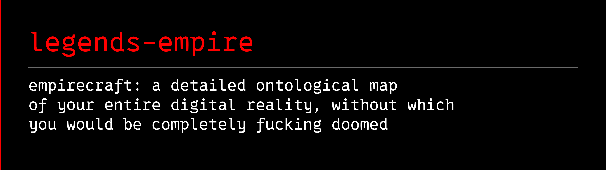
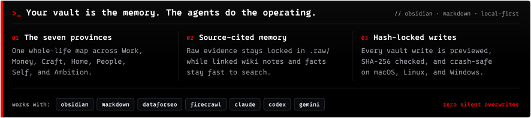
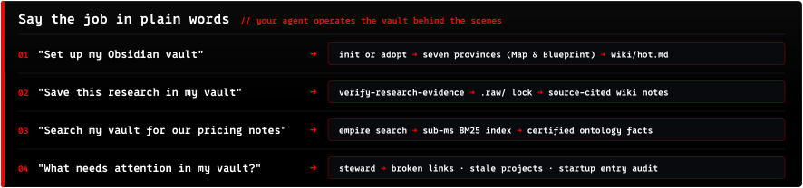
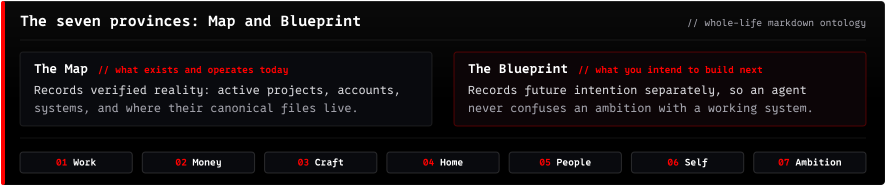
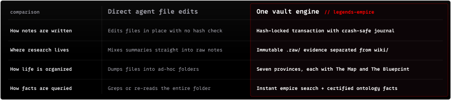

<p align="center"></p>

# legends-empire: turn your Markdown Empire vault into AI agent memory and a business ontology

[](https://github.com/avalonreset/legends-empire/releases/latest)
[](https://github.com/avalonreset/legends-empire/actions/workflows/test.yml)
[](docs/install-guide.md)
[](LICENSE)

Every coding agent session begins with amnesia unless your agent has a durable memory it cannot corrupt. Point a raw assistant directly at your folder of notes and it will edit files in place, break wikilinks, bloat startup instructions, and blend invented summaries straight into primary research.

**Your vault is the memory. The agents do the operating.**

`legends-empire` turns any local Markdown folder into a structured Empire vault and source-cited AI agent memory. You speak to your agent in plain english, and `legends-empire` keeps raw evidence quarantined from synthesized wiki notes, organizes your digital reality across seven provinces you actually own, and protects every file write behind a previewed, hash-locked transaction.

<p align="center"></p>

```text
Set up legends-empire through cto-legends and initialize or adopt my Markdown vault,
showing me the plan before writing any files.
```

<p align="center"></p>

[Plain english](#ai-agent-memory-in-plain-english) · [Seven provinces](#the-seven-provinces-map-and-blueprint) · [Source-cited memory](#why-source-cited-memory-beats-raw-agent-file-edits) · [Stewardship & ontology](#vault-stewardship-instant-search-and-the-ontology-engine) · [Reference](#reference)

---

## AI agent memory in plain english

You should never have to babysit file paths, frontmatter schemas, or SHA-256 digests by hand just to keep a Markdown vault clean. You tell your coding agent what you want remembered, searched, or audited in normal words, and [`cto-legends`](https://github.com/avalonreset/cto-legends) routes the job straight to `legends-empire`.

<p align="center"></p>

Here are four everyday sentences `legends-empire` was built to answer.

**"Set up my Markdown Empire vault."**

Whether you are starting a brand-new folder or adopting a vault you have lived in for years, `legends-empire` previews every file before touching your disk. New vaults receive the complete Seven Provinces starter map, the `wiki/hot.md` doorway for fast agent orientation, an `inbox/` drop zone, and an immutable `.raw/` evidence store. Existing vaults are adopted non-destructively without overwriting a single note or workspace setting you customized by hand.

**"Save this research in my vault."**

When [`legends-dataforseo`](https://github.com/avalonreset/legends-dataforseo) pulls live Google search demand or [`legends-firecrawl`](https://github.com/avalonreset/legends-firecrawl) scrapes a competitor's site and PDF brochures, they export portable evidence packages bound to a cryptographic manifest. `legends-empire` verifies every byte offline, locks the raw files inside `.raw/` so primary data is never altered, and synthesizes source-cited wiki notes that link back to the exact origin.

**"Search my vault for our pricing notes."**

Instead of grepping thousands of random lines or re-reading your entire folder into the context window on every turn, your agent queries the local search index (`empire search`) and the ontology index in milliseconds. It gets back the exact notes, frontmatter facts, and source citations relevant to your question.

**"What needs attention in my vault?"**

Vault stewardship scans your Markdown knowledge base read-only for broken wikilinks, orphan notes, expired freshness windows, and stale project pages. It also audits your coding agent startup files (`CLAUDE.md`, `AGENTS.md`, `GEMINI.md`) so your agent instructions stay lean, consistent across hosts, and free of duplicated rules.

---

## The seven provinces: Map and Blueprint

Your digital reality is already scattered across folders, repositories, servers, financial records, and half-built ideas. The challenge is keeping track of what actually exists today versus what you intend to build tomorrow.

`legends-empire` ships a whole-life starter framework organized into seven provinces. Inside every province live two distinct sections: **The Map** and **The Blueprint**.

<p align="center"></p>

**The Map** records verified reality: what is live right now, where its canonical files or repositories sit, and when it was last checked. **The Blueprint** records future intention. Keeping them separate enforces one crucial discipline for both humans and AI agents: a planned system is never confused with a working system, and an unwritten ambition stays unwritten until you decide what it is.

| Province | Starter path | What lives here |
| --- | --- | --- |
| **Work** | `wiki/work/Work.md` | Active operations, ventures, client deliveries, and commitments consuming your attention |
| **Money** | `wiki/money/Money.md` | Resources, obligations, pricing, runway, ownership, and the room you have to maneuver |
| **Craft** | `wiki/craft/Craft.md` | The things you make and the disciplines you sharpen because mastery and taste matter |
| **Home** | `wiki/home/Home.md` | The physical world you inhabit, your property and hardware, and the household machinery |
| **People** | `wiki/people/People.md` | Relationships, promises, collaborators, and the allies who matter beyond a transaction |
| **Self** | `wiki/self/Self.md` | Health, energy, capacity, operating rhythm, and the human running all of this machinery |
| **Ambition** | `wiki/ambition/Ambition.md` | What all of the machinery is for: long-range targets before they become active Work projects |

The provinces organize attention without forcing you to move your existing project folders or git repositories. Your operational folders stay right where they work best, while the seven provinces act as your navigable map over the whole terrain.

---

## Why source-cited memory beats raw agent file edits

Giving a coding agent raw filesystem write access to your personal or company notes feels convenient until the first time an assistant silently overwrites a decision log, invents a citation, or deletes an unlinked receipt during "cleanup."

<p align="center"></p>

`legends-empire` treats your Markdown vault with the same rigor a database engineer gives a production ledger:

- **One canonical home per fact.** Raw captures and API payloads live in `.raw/` bound to a SHA-256 source ledger. Human-readable synthesis lives in `wiki/`. An agent summary never overwrites the primary source behind it.
- **Hash-locked write transactions.** Every proposed mutation binds each target file to its expected prior SHA-256 digest. If you edited a note in your code editor while the agent was thinking, the transaction halts cleanly instead of clobbering your work.
- **Crash-safe recovery across macOS, Linux, and Windows NTFS.** Every transaction records a private recovery journal before modifying files, so an interrupted process can be rolled back to a verified state in one step.
- **Hot doorway orientation (`wiki/hot.md`).** Instead of stuffing your entire vault into every prompt, `wiki/hot.md` gives your coding agent a short, current doorway into what matters right now and where the deeper notes live.

---

## Vault stewardship, instant search and the ontology engine

As a Markdown knowledge base grows from fifty notes to five thousand, three capabilities keep it fast and trustworthy without turning your files into a proprietary database.

### Instant local search and hybrid retrieval

Your notes remain plain `.md` files on your own drive, ready to open in any code editor or terminal at any moment. Behind the scenes, `legends-empire` indexes headings, wikilinks, and note bodies locally so your agent can run instant BM25 and contextual retrieval searches offline without sending your private vault to a third-party vector cloud.

### The ontology engine

Standard Markdown frontmatter becomes an answerable fact graph ([docs/ontology.md](docs/ontology.md)). You and your agent can declare structured entities, aliases, and certified frontmatter facts while preserving every byte of your human prose below the frontmatter fence. Automated workflows can check whether a required fact is fresh and certified before acting, halting safely when key information is still a draft or out of date.

### Vault stewardship and attachable knowledge packs

Running a stewardship check (`legends-vault-stewardship`, bundled inside the same installation) gives your agent a repeatable health report: broken wikilinks, unreadable files, expired freshness dates, and drift across your coding agent entry files.

Stewardship also lets you attach curated Markdown knowledge packs ([docs/knowledge-packs.md](docs/knowledge-packs.md)) from sibling modules such as [`legends-hetzner`](https://github.com/avalonreset/legends-hetzner), [`legends-coolify`](https://github.com/avalonreset/legends-coolify), and [`legends-cloudflare`](https://github.com/avalonreset/legends-cloudflare), bringing verified infrastructure runbooks straight into your vault without touching your private notes.

---

## Reference

Everything you need to run `legends-empire` through your coding agent is in the essay above. Open these drawers whenever you want the CLI command reference, architecture layout, or release notes.

<details>
<summary><strong>CLI reference and agent setup</strong></summary>

<br>

### Agent setup (via `cto-legends`)

Part of the [`cto-legends`](https://github.com/avalonreset/cto-legends) ecosystem. `cto-legends` is the only registered skill; this repository vendors a pinned copy at [skills/cto-legends/SKILL.md](skills/cto-legends/SKILL.md). Install via `cto-legends install legends-empire` and let the router resolve [docs/AGENT-RECIPE.md](docs/AGENT-RECIPE.md) on demand. Do not register this module as a standalone skill folder.

```sh
python -m cto_legends --home <cto-legends-home> sync --apply
python -m cto_legends --home <cto-legends-home> install legends-empire --apply
python -m cto_legends --home <cto-legends-home> handoff legends-empire
```

Run vault memory, search, ontology, or stewardship commands through the router from any working directory:

```sh
python -m cto_legends --home <cto-legends-home> run legends-empire -- --help
python -m cto_legends --home <cto-legends-home> run legends-vault-stewardship -- steward --help
```

| Surface | Key subcommands | What it does |
| --- | --- | --- |
| Vault setup & memory | `init`, `adopt`, `doctor`, `capture`, `plan-transaction`, `apply-transaction`, `recover`, `checkpoint` | Non-destructive Seven Provinces initialization, source-cited capture, hash-locked transactions, and crash recovery |
| Search & retrieval | `search` (`retrieve.py`, `bm25-index.py`, `read-hot-cache.sh`) | Instant local search, BM25 indexing, and `wiki/hot.md` orientation |
| Research intake | `verify-research-evidence`, `plan-research-intake` | Offline SHA-256 verification and intake planning for `legends-dataforseo` and `legends-firecrawl` evidence packs |
| Ontology engine | `ontology resolve`, `ontology ask`, `ontology need`, `ontology propose`, `ontology certify`, `ontology bench` | Sub-millisecond entity resolution, frontmatter fact queries, prerequisite gating, and differential frontmatter updates |
| Vault stewardship | `steward scan`, `steward observe`, `steward review`, `steward entry-audit`, `steward digest`, `steward law` | Read-only link and freshness audits, multi-vendor agent startup audits, and attachable `legends.knowledge-pack/v1` packs |

</details>

<details>
<summary><strong>Vault layout, platform support and attribution</strong></summary>

<br>

```text
Empire Markdown Vault (user-owned files)
  +-- wiki/
  |     +-- hot.md, index.md, overview.md, log.md
  |     +-- work/Work.md, money/Money.md, craft/Craft.md, home/Home.md
  |     +-- people/People.md, self/Self.md, ambition/Ambition.md
  |     +-- meta/ (ledgers and ontology starter)
  +-- inbox/ (drop zone for captures and research intake)
  +-- .raw/ (immutable SHA-256 primary evidence archive)
```

- **Platform support.** Runs locally in Python 3.11+ using the standard library across Linux, macOS, and native Windows NTFS vaults ([docs/windows-wsl.md](docs/windows-wsl.md)). Network shares, symlinks, and reparse points are refused as write targets.
- **Optional Home compatibility.** AI Marketing Hub Home fits an [optional shared-root capability slot](docs/home-adapter.md); standalone `legends-empire` vaults remain completely independent.
- **Guides and docs.** [Operating recipe](docs/AGENT-RECIPE.md), [installation guide](docs/install-guide.md), [stewardship guide](docs/stewardship.md), [ontology guide](docs/ontology.md), [knowledge packs](docs/knowledge-packs.md), [research evidence handoff](docs/RESEARCH-EVIDENCE-HANDOFF.md), and [search strategy](docs/SEARCH-STRATEGY.md).
- **Attribution & license.** Released under the [MIT License](LICENSE). Incorporates source-cited wiki and memory foundations from [claude-obsidian](https://github.com/AgriciDaniel/claude-obsidian) by Daniel Agrici ([AgriciDaniel](https://github.com/AgriciDaniel)); full notices are preserved in [ATTRIBUTION.md](ATTRIBUTION.md), [NOTICE](NOTICE), [THIRD_PARTY_NOTICES.md](THIRD_PARTY_NOTICES.md), [CITATION.cff](CITATION.cff), [CONTRIBUTING.md](CONTRIBUTING.md), [SUPPORT.md](SUPPORT.md), and [SECURITY.md](SECURITY.md).

</details>

## Start here

Paste the [agent handoff block](#legends-empire-turn-your-markdown-empire-vault-into-ai-agent-memory-and-a-business-ontology) at the top of this page into your coding agent, let it wire `legends-empire` through [`cto-legends`](https://github.com/avalonreset/cto-legends), and give your agent a vault memory that compounds across every session.

<p align="center"><a href="https://github.com/stars/avalonreset/lists/cto-legends"></a></p>

Running a company and want this vault architecture and agent stack applied directly to your business? Message Avalon Reset at [cto-legends.com/dm](https://cto-legends.com/dm). The desk is async, so the conversation starts the moment you write and nobody forces you onto a sales call.

<p align="center"><a href="https://cto-legends.com/dm"></a></p>

---

**Specification & benchmarks on cto-legends.com:**
- **Module specification & architecture matrix:** [cto-legends.com/modules/legends-empire](https://cto-legends.com/modules/legends-empire)
- **Related engineering dispatches:** [AI Agent Governance: Markdown Knowledge Base & Vault Architecture](https://cto-legends.com/blog?post=ai-agent-governance) · [How to Build AI Agents: Production CLI & MCP Routing](https://cto-legends.com/blog?post=how-to-build-ai-agents-cli-mcp-routing) · [Fractional CTO Advisory: Technical Due Diligence Guide](https://cto-legends.com/blog?post=fractional-cto-technical-due-diligence-guide)
- **Ecosystem hub:** [cto-legends.com/home](https://cto-legends.com/home)
